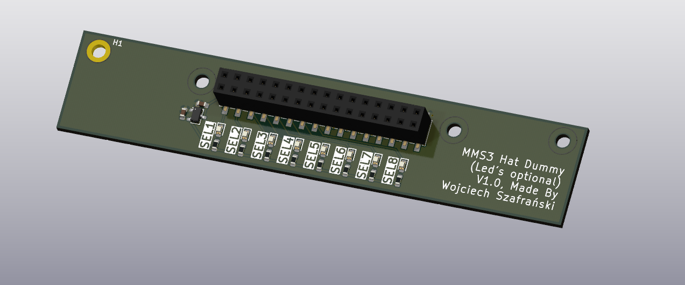

# MMS3 hat Dummy

## Sekcja 1: Dokumentacja Hat'a

### Krótki opis projektu
Hat Dummy to dystans mechaniczny. Tylko tyle

### Zgodność ze standardem ChainBus

* ❌ Używa złącza ChainBus, nie zmienia jego miejsca ani pinoutu. -> nie przesuwa addresów hat'a. Robi za głupi dystans mechaniczny
* ✅  Używa wyłącznie interfejsów I2C, SPI lub UART i nie inicjuje samodzielnie nowych transmisji (Nie jest master'em I2C albo SPI).
* ❌ Spełnia wymagania mechaniczne standardu (wymiary PCB, rozstaw otworów). -> Jest troche mniejszy
* ✅ Pobiera maksymalny prąd zgodny z ilością na jednego hat'a
* ✅ Obsługuje napięcie wejściowe BRD_VIN do wartości 48V.

### Komunikacja i adresowanie

Hat nie ma na sobie żadnych urządzeń

### Pinout złączy
Brak

### Konfiguracja układu (Zworki/Rezystory)
Brak

### Szczegółowy opis techniczny
Hat Dummy to dystans mechaniczny. Możesz go dać jeśli potrzebujesz mieć fizycznie więcej miejsca miedzy hat'ami. Nie zużywa adresu hat'a -> możesz go włożyć w dowolne miejsce między inne hat'y i elektrycznie ani programowo się nic nie zmieni

### Gotowe arkusze hierarchiczne
Brak

---

## Sekcja 2: Specyfikacja standardu ChainBus

### Architektura i łączenie modułów
Standard ChainBus umożliwia modułowe łączenie hatów. Na jednym MMS3 można zamontować pionowo **do 8 hat'ów**. Połączenie realizowane jest poprzez wpięcie złącza męskiego kolejnego hat'a w złącze żeńskie poprzedniego

### Komunikacja i sterowanie
Magistrala ChainBus jest w pełni cyfrowa. Płyta główna nie steruje bezpośrednio sygnałami ogólnego przeznaczenia (GPIO) na poszczególnych hat'ach. Wszelkie operacje (np. obsługa diod LED, odczyt krańcówek, generowanie sygnałów PWM) muszą być realizowane przez dedykowane układy scalone (np. ekspandery portów, sterowniki) komunikujące się przez interfejsy systemowe.

*Przykład:*
`MCU` $\rightarrow$ `Expander GPIO po I2C` $\rightarrow$ `Dioda LED`

Wybór aktywnego modułu realizowany jest przez układ przełącznika magistrali (bus switch) na płycie głównej. Dzięki temu linie I2C, SPI i UART są niezależne dla każdego hat'a (brak konfliktów adresów I2C między różnymi hatami).
* **Identyfikacja:** Każdy moduł powinien posiadać pamięć EEPROM na magistrali I2C w celu identyfikacji płyty przez system - układ M24C64-W skonfigurowany na adres `1010000` przy liniach adresowych A0, A1, A2 zwartych do masy.

### Zasilanie
Złącze ChainBus dostarcza następujące linie zasilania:

| Magistrala zasilania | Napięcie znamionowe | Maksymalny prąd (łączny dla 8 hatów) | Szacowany prąd na jeden hat |
| :------------------- | :-----------------: | :----------------------------------: | :-------------------------: |
| **5V**               |        5.0 V        |                1.0 A                 |           125 mA            |
| **12V stby**         |       12.0 V        |                0.5 A                 |            65 mA            |
| **BRD_VIN**          |   12.0 V – 48.0 V   |                1.5 A                 |           185 mA            |

*   Komponenty podłączone do linii `BRD_VIN` muszą być przystosowane do pracy z napięciem od 12V do **48 V**.
*   W przypadku zapotrzebowania na wyższą moc, dopuszczalne jest zastosowanie dodatkowego złącza zasilania XT60 (obciążalność do ok. 60 A).

### Wymagania mechaniczne i złącza
* **Wymiary PCB:** Niedozwolona jest zmiana obrysu płytki oraz położenia otworów montażowych, aby zachować kompatybilność mechaniczną.
* **Pozycjonowanie złączy ChainBus:** Położenie złącza standardu 2x16 SMD (raster 2.54 mm) musi być zgodne z szablonem. Złącze żeńskie montowane jest na stronie FRONT, natomiast złącze męskie na stronie BACK.
* **Interfejsy zewnętrzne:** Złącza wejścia/wyjścia (domyślnie standard JST-XH 2.5 mm o obciążalności do 3 A) oraz opcjonalne złącze XT60 powinny być umieszczone przy dolnej krawędzi płytki. Elementy regulacyjne i sygnalizacyjne (potencjometry, przełączniki, diody LED) należy lokalizować przy prawej krawędzi płytki.
* **Komponenty** Wszystkie komponenty powinny być na stronie front płytki żeby nie haczyły o elementy ze wcześniejszego hat'a

---

## Sekcja 3: Licencje

### Licencje projektu

*   **PCB:** CERN-OHL-P
*   **Software:** MIT License

[Template](https://github.com/KoNaR-Hefajstos/MMS3_hat_templates/) jest na licencji CC0 1.0 Universal. **Reszta projektu nie jest na tej licencji**
